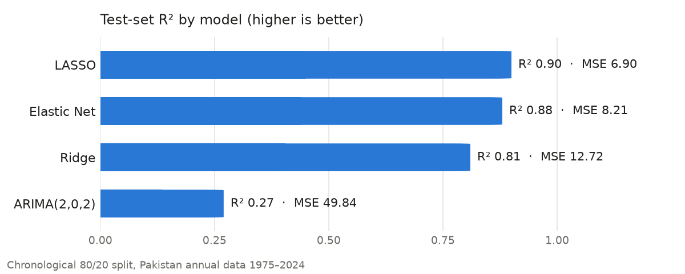

# Forecasting Inflation in Pakistan

Can macroeconomic indicators forecast Pakistan's annual CPI inflation better than inflation's own history? This project compares a pure time-series model (**ARIMA**) with three regularized regressions (**Ridge, LASSO, Elastic Net**) on 50 years of World Bank data (1975–2024).

<picture>
  <source media="(prefers-color-scheme: dark)" srcset="assets/model_comparison_dark.png">
  
</picture>

## Key findings

| Model | Test R² | Test MSE | Tuned λ |
|---|---|---|---|
| **LASSO** | **0.90** | **6.90** | 0.117 |
| Elastic Net (α = 0.5) | 0.88 | 8.21 | 0.122 |
| Ridge | 0.81 | 12.72 | 0.276 |
| ARIMA(2,0,2) | 0.27 | 49.84 | — |

- **Macroeconomic predictors help a lot.** Every regularized regression beat ARIMA by a wide margin. Inflation's own history alone explains only about a quarter of the test-set variance.
- **LASSO is best.** Its variable selection matters here: with 13 correlated predictors and about 50 annual observations, dropping weak predictors beats shrinking all of them (Ridge).
- **The most informative predictors** are lagged inflation, GDP growth, the official exchange rate, and imports as a share of GDP.
- **Caveat:** the test set is the last ~10 years, which includes the 2022–23 inflation spike (30.8% in 2023). With so few annual observations, these numbers are indicative, not definitive.

The full analysis is in the [report (PDF)](FinalReport.pdf).

## Method

1. **Data:** 47 World Bank WDI series for Pakistan, 1975–2024 ([`PK_FinData_1975_2024.csv`](PK_FinData_1975_2024.csv)). The data is transposed to one row per year, and missing values are mean-imputed.
2. **Features:** 10 macro indicators chosen by correlation with inflation (GDP and per-capita growth, exchange rate, imports, trade, industry and manufacturing value added, government borrowing, capital formation), plus two inflation lags and a 3-year rolling mean.
3. **Split:** chronological 80/20 (train on the earlier years, test on the most recent), with no shuffling, so the models never see the future.
4. **Models:** `forecast::arima` and `glmnet::cv.glmnet` (α = 0, 1, 0.5), with λ chosen by cross-validation. An OLS fit is also run, for p-values only.
5. **Diagnostics:** summary statistics, boxplots, a pairplot and a correlation heatmap.

## Running

```r
install.packages(c("tidyverse", "reshape2", "GGally", "forecast", "glmnet", "zoo"))
source("InflationForecasting.R")
```

The script prints each model's summary and test metrics, and writes the EDA plots as PNGs.

## Authors

Muneeb Lone and Rida Zubair, supervised by Hazber Samson (FAST-NUCES Islamabad).
